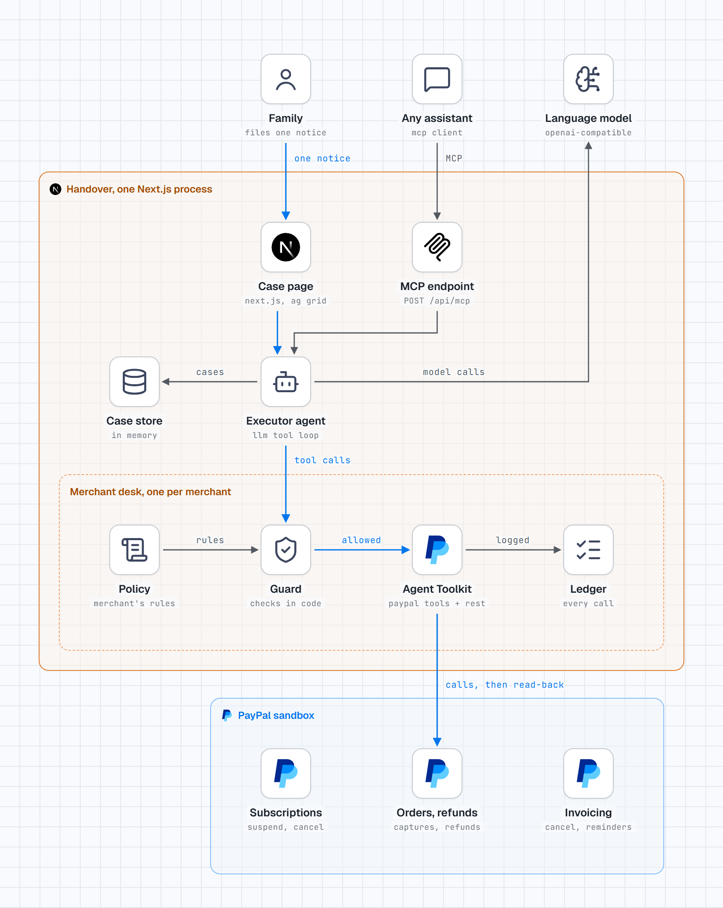

# Handover

**One notice settles every payment a person left behind.**

When someone dies, their payments keep running. The family has to find every subscription, membership and open bill, then contact each merchant and send the same documents again.

Handover is an executor agent for the family. They file one notice. The agent finds what the person was paying for at participating merchants, proposes what to do with each item, and after the family approves, carries it out on PayPal: close, take over, pause, refund, waive. Each merchant's own rules limit what the agent can do, and every result is read back from PayPal before it is shown as done.

Built for the PayPal AI Hackathon 2026. Everything runs on the **PayPal sandbox**. The people and merchants in the demo are fictional. No real money moves.

- Live demo: _added at submission_
- Video: _added at submission_

## What a run looks like

1. **Notice.** The family gives the person's name, known email addresses, the date of death, their wishes in their own words, and a document (a funeral notice, pasted or as an image). The agent reads the document and compares the name and date with the notice.
2. **Plan.** The agent asks each merchant's desk what it holds for that person, checks the live state of each item on PayPal, reads the merchant's bereavement policy, and proposes one action per item with a reason. The family can change any row.
3. **Done.** After approval the agent carries out the plan through the desks. Each row ends as confirmed with PayPal, waiting on the family, or blocked with the reason. The family gets a closing statement.
4. **Hand-over.** A take-over creates a replacement subscription in the family member's name and pauses the old one. When they approve the new one at PayPal, the old one is cancelled and the row is done.

Until the document matches the notice, only reversible steps are available: "Pause everything for now", and "Resume everything" to undo it.

### The demo estate

Each demo run creates a fresh estate on the sandbox for Daniel Reyes, filed by his daughter Maria.

| Merchant | Item | What the agent is expected to do |
|---|---|---|
| Lumen Stream | Family plan, $17.99 a month, charged again after the date of death | Hand it over to the family, refund the later charge |
| Ironwood Gym | Membership, $39 a month | Close it, refund the unused days |
| Ironwood Gym | Annual locker, $120 prepaid | Refund the unused part of the year |
| Ironwood Gym | Invoice, $90, three training sessions never taken | Stop the reminders, cancel the invoice |
| Harbor Light Food Bank | Monthly gift, $25, taken again after the date of death | Continue it in the family's name, ask before taking the later gift back |

The three merchants have different policies on purpose, and Ironwood Gym also has a customer with a similar name and a different email, which the agent must leave alone.

## How it is built

<picture>
  <source media="(prefers-color-scheme: dark)" srcset="docs/architecture-dark.png">
  
</picture>

The blue path is a settlement: one notice, the agent's tool calls, the guard, then PayPal. The editable source of the diagram is [docs/architecture.html](docs/architecture.html).

- **Agent** (`lib/agent.ts`): an OpenAI-compatible chat-completions tool loop with five phases: intake, plan, pause, resume, execute. It has no PayPal credentials. Its tools are whatever the merchant desks list for the current phase.
- **Merchant desk** (`lib/desk.ts`): one per merchant. It lists tools, checks every call against the guard, then calls PayPal with that merchant's credentials and records the call in the merchant's ledger.
- **Guard** (`lib/guard.ts`): pure functions, unit tested. See the next section.
- **PayPal** (`lib/paypal.ts`): the [PayPal Agent Toolkit](https://github.com/paypal/agent-toolkit) (`@paypal/agent-toolkit/openai`) for `show_subscription_details`, `cancel_subscription`, `create_subscription`, `create_refund`, `get_refund`, `get_order`, `get_invoice`, `cancel_invoice_auto_reminder`, `cancel_sent_invoice` and `generate_invoice_qr_code`, with the toolkit's own tool schemas passed to the model. Two calls the toolkit does not have, suspend and activate subscription, go to the REST API directly, as does seeding the demo estate.
- **UI**: Next.js App Router. AG Grid for the plan and for each merchant's ledger. The agent's activity streams to the page over server-sent events.
- **MCP** (`lib/mcp.ts`, `POST /api/mcp`): Handover is also an MCP server, so a family's own assistant can file the notice, show the plan, and approve it on their word. Same functions as the web page, same guard.

The agent and the desks run in one process. The separation between them is at module level, not process level: the agent module is never handed credentials, but this is not an isolation boundary you should rely on in production.

## What the code decides, not the model

Every write passes the guard before it reaches PayPal. A refusal goes back to the agent with the reason and appears in the activity stream.

1. **Ownership.** A call may only target an object in that merchant's records for a customer whose email exactly matches one the family gave. Near matches are shown to the family and cannot be acted on.
2. **Reversible first.** Before the document matches, only suspend and its undo are allowed. Cancelling, refunding, waiving and creating a replacement subscription need a matched document and an approved plan.
3. **Approval.** An irreversible call must match a row and action the family approved.
4. **Money.** Refund amounts are computed in code from the charge's service period, the date of death and the merchant's policy. The desk overwrites whatever amount the model sends.
5. **Once.** Each irreversible step runs once and carries a PayPal request id derived from the case and item.
6. **Read-back.** After the agent reports an outcome, code re-reads the object from PayPal. The page says "confirmed" only when PayPal agrees.

**What this does and does not protect against.** A refund can only return to the payment method that paid, so a notice cannot send money to whoever filed it. A false notice could still cause refunds to the original payer, a waived invoice and cancelled subscriptions at the merchant's cost. That is why irreversible steps need a matched document, and why a real deployment needs real proof-of-death checking. This build's document check is demo-grade: the agent reads the document and code compares the name and date. It does not verify the document is genuine.

## What is real and what is not

- Real, on the PayPal sandbox: every subscription, capture, refund, invoice, suspension and cancellation shown in the app. Ids in the UI are PayPal's.
- Sandbox objects are created minutes before each demo run, so PayPal timestamps are recent. Service periods come from the merchant's own records.
- Sandbox subscription billing is asynchronous, so a new subscription's first payment may not exist yet when the demo runs. Each period charge in the demo is therefore a separate sandbox card capture, taken by the same merchant from the same payer and linked to the account in the merchant's records.
- Merchant records (who the customer is, which charge belongs to which account, service periods) are held in memory by the app and seeded per run.
- Not built: real proof-of-death checking, merchants that are not connected, the person's own PayPal account and balance.
- State lives in memory. A restart clears open cases; start a new demo case.

`PAYPAL_FAKE=1` swaps PayPal for an in-memory fake so the app can be developed and tested without credentials. It shows a permanent red banner and is never used for the hosted demo.

## How this differs from a legacy plan

Some tools let a person arrange in advance what should happen to their accounts or their AI agents' spending. Those help the people who set them up. Handover needs nothing set up beforehand: it starts from the family, works on the merchant side, and settles what exists (closes, refunds, transfers), not only pauses it.

## Run it yourself

Requirements: Node 22 or later, a PayPal developer account, an API key for any provider with an OpenAI-compatible chat completions endpoint.

1. In the [PayPal developer dashboard](https://developer.paypal.com/dashboard/), create **US** sandbox business accounts and a REST app for each (one is enough; with one, the three demo merchants share it and the UI says so). Enable Advanced Credit and Debit Card Payments on the app.
2. Copy `.env.example` to `.env.local` and fill it in.
3. `npm install`
4. `npm run probe` prints what your sandbox account can do (invoices, card captures, card-funded subscriptions).
5. `npm run dev`, open http://localhost:3000 and press "Try the demo case".

Checks:

- `npm test`: guard rules, refund arithmetic, customer matching, plan validation, desk behaviour, the MCP endpoint.
- `npm run e2e`: seeds an estate and runs intake, pause, resume, plan, execution and a take-over approval end to end, then asserts the resulting PayPal states. With no credentials it runs against the fake backend and a scripted stand-in for the model, and adds two more runs: a PayPal failure in mid-execution, and a model that misbehaves (refunds at the wrong desk, an unknown id, a refund the family did not approve, a duplicate refund, an early cancellation). Every such call is refused and the approved plan still completes.

## Use it from another assistant (MCP)

Add `https://<your-host>/api/mcp` to any MCP client as a Streamable HTTP server. Tools: `start_demo_case`, `file_notice`, `get_case`, `change_decision`, `approve_and_carry_out`, `pause_everything`, `resume_everything`, `check_take_over_approval`.

With Claude Code, for example: `claude mcp add --transport http handover https://<your-host>/api/mcp`, then ask it to start a demo case and walk you through the plan.

## Tools and models used

- PayPal: Orders v2, Payments v2 refunds, Subscriptions v1, Invoicing v2, through the PayPal Agent Toolkit and REST; PayPal sandbox.
- Model: _filled in at submission_ through an OpenAI-compatible endpoint, for reading the document, planning and execution.
- AG Grid Community for the grids. Next.js and React.
- Claude Code (Anthropic) wrote most of the code and documents under the author's direction.

## License

MIT. See [LICENSE](LICENSE).
