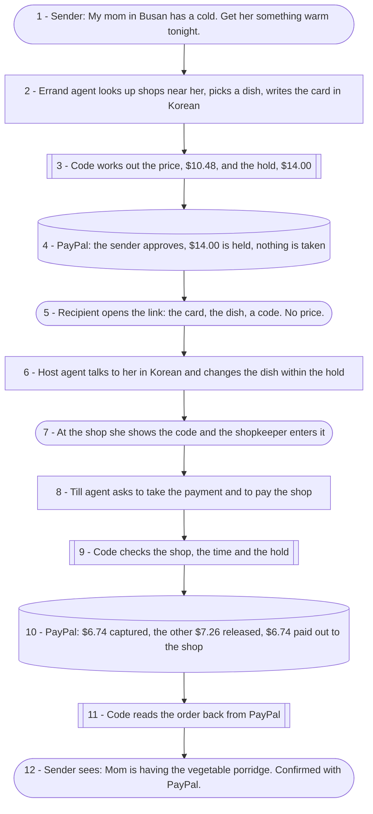
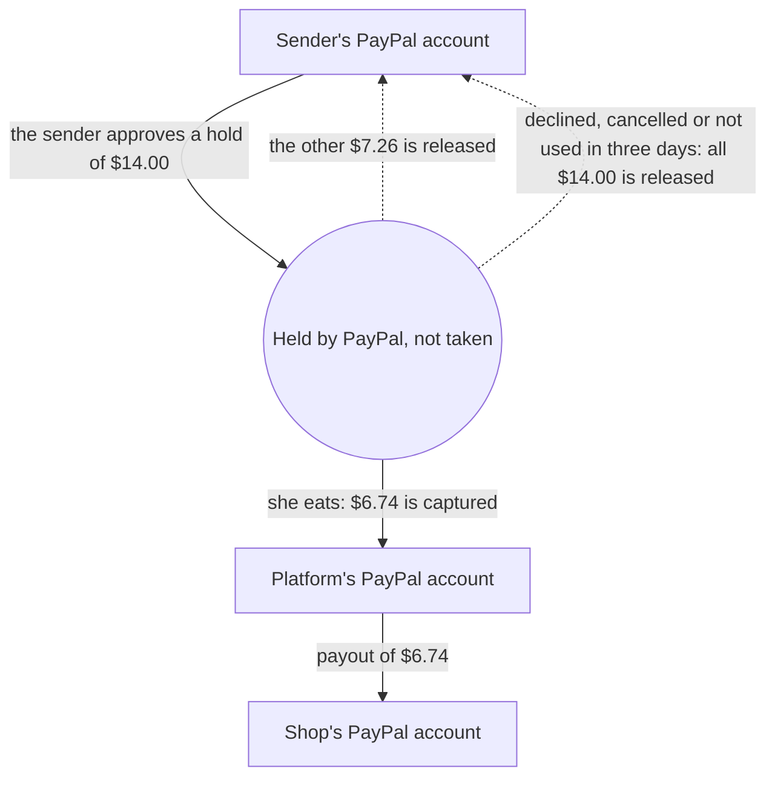
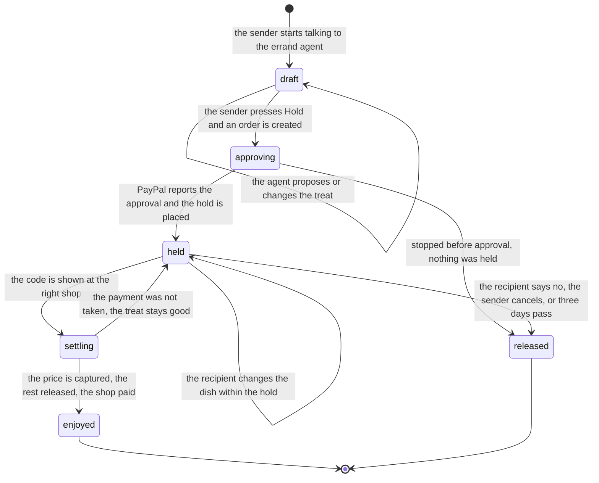
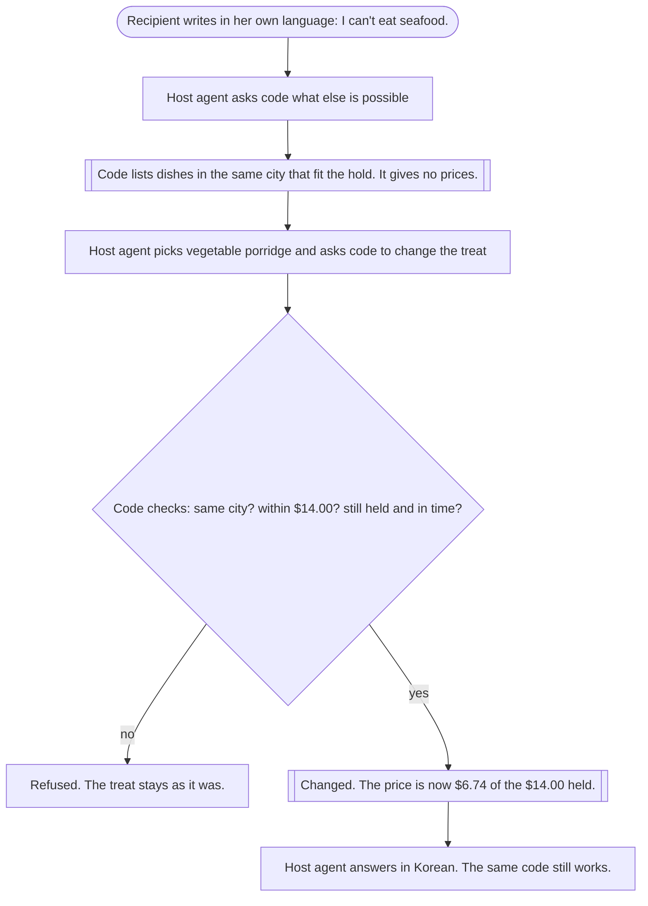
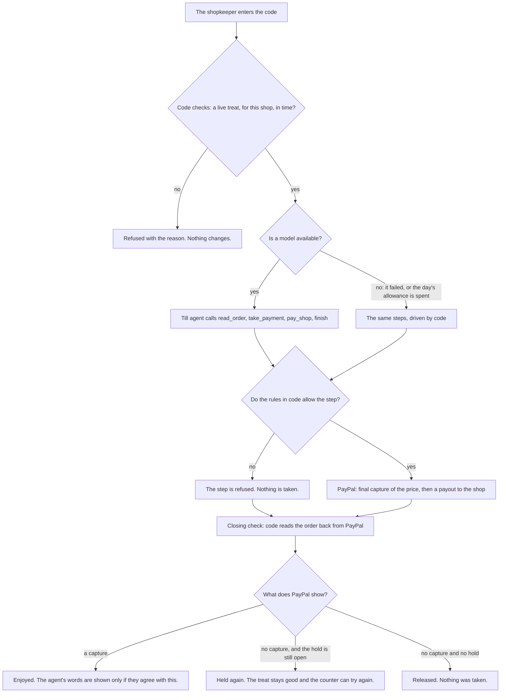
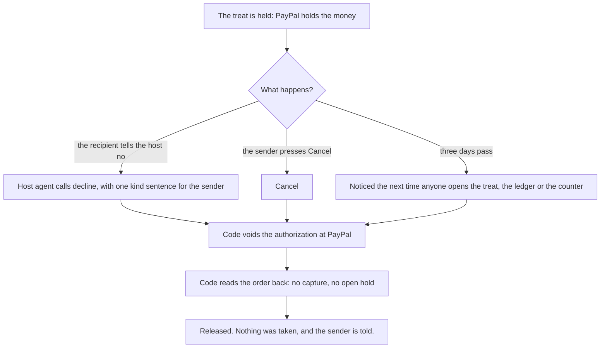
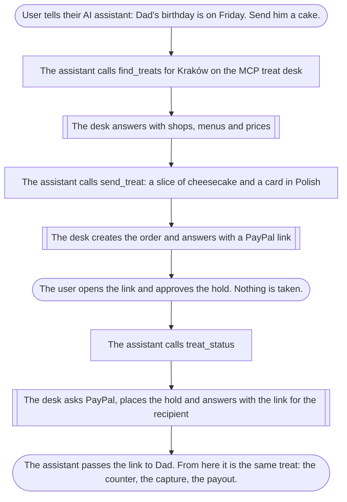

# Have You Eaten?

**Tell an agent who you miss. It buys them a meal at the shop next door, and you pay only when they eat.**

An entry for the PayPal AI Hackathon 2026. It runs on the PayPal sandbox only: no real money moves. The shops, the shopkeepers and the people are fictional.

- Repository: https://github.com/55wind/have-you-eaten
- Live demo: **TODO** (Render address, added after deployment)
- Video: **TODO** (YouTube address, added after recording)

## Why

In many languages "have you eaten?" is how people say they care. When the person you care about lives in another city or country, you cannot put a bowl of soup in front of them.

Have You Eaten? lets you say it in one sentence: "My mom in Busan has a cold, get her something warm tonight." You do not need to know the shops, the menu or the language. An agent does that part, and PayPal holds the money until she has eaten.

## How it works

1. **One sentence.** The sender says who it is for, where they are and what is going on. An errand agent looks up shops near the recipient, picks one dish and writes the card twice: in the recipient's language and in the sender's. Code works out the price in US dollars and the amount to hold.
2. **PayPal holds, and takes nothing.** The sender approves a PayPal order with intent `AUTHORIZE`. Code places the hold only after PayPal reports the approval. The sender gets a link to pass on.
3. **The recipient chooses.** The link opens the card, the dish, the shop and a code for the counter. It shows no price. A host agent talks to the recipient in their language. It can change the dish within what is held, note when they will go, pass on a thank-you, or take a polite no.
4. **They eat, and only then is money taken.** At the shop's counter the recipient shows the code. A till agent takes exactly the price of the dish with a final capture, which releases the rest of the hold, and pays the shop with a PayPal payout. If the treat is declined, cancelled or not used in three days, the hold is voided and nothing is taken.

Example, from the end-to-end check below: abalone porridge in Haeundae costs ₩14,000, which is $10.48, and PayPal holds $14.00. The recipient cannot eat seafood, so the host changes it to vegetable porridge, ₩9,000 or $6.74. At the counter $6.74 is taken and $7.26 is released.

### Who does what

| Part | Who | What |
|---|---|---|
| The errand | Errand agent (LLM with tools) | Understands the sentence, looks up shops and menus near the recipient, picks one dish with a reason, writes the card in both languages. |
| The host | Host agent (LLM with tools) | Talks to the recipient in their language. Changes the treat within what is held, notes a visit, passes on a thank-you or a no, translated for the sender. It is never given a price. |
| The till | Till agent (LLM with tools) | At the counter: reads the PayPal order, takes the price, pays the shop, writes one sentence for the shop and one for the sender. |
| Money and limits | Code (`lib/rules.ts`) | Every amount, the conversion, the size of the hold, the right shop, one use per code, the three-day limit. After each settlement code reads the order back from PayPal, and the page says "Confirmed with PayPal" only from that reading. |
| The money | PayPal | A hold on the sender (order with intent `AUTHORIZE`), a final capture of part of it at the counter, a void if unused, a payout to the shop. |
| Other people's assistants | MCP | `find_treats`, `send_treat`, `treat_status`: a personal AI assistant can send a treat for its user. |

## Architecture

<picture>
  <source media="(prefers-color-scheme: dark)" srcset="docs/architecture-dark.png">
  
</picture>

The blue path is one treat, in the order of the numbers. The source of the picture is [docs/architecture.html](docs/architecture.html).

- **Rules** (`lib/rules.ts`): pure functions with unit tests. The price in dollars, the size of the hold, and the three decisions: may this be proposed, may the recipient change it, may the counter take payment.
- **Shops** (`lib/shops.ts`): 11 fictional shops in 5 cities (Busan, Lagos, Mexico City, Manila, Kraków) with their menus in their own currency, the exchange-rate table, the three-day limit and the $40.00 limit.
- **Treats** (`lib/treats.ts`): what can happen to a treat: open, propose, start the checkout, place the hold, change, release, and the views for the sender, the recipient and the ledger. The web routes, the agents and the MCP endpoint all call it.
- **Agents** (`lib/agent.ts`, `lib/errand.ts`, `lib/host.ts`, `lib/till.ts`): one model client and one tool loop shared by the three agents.
- **PayPal** (`lib/paypal.ts`): the sandbox backend. `lib/paypal-fake.ts` is a stand-in for development and tests.
- **MCP treat desk** (`lib/mcp.ts`, `app/api/mcp/route.ts`).
- **Store** (`lib/store.ts`): treats, their activity log and the daily caps, in memory. The sender's and the recipient's pages follow a treat over server-sent events.
- **Pages**: `/` (landing), `/send` (the sender and the errand agent), `/treat/[id]` (the sender's page: link to share, activity, result, PayPal's ids), `/t/[code]` (the recipient), `/shop/[id]` (the counter), `/ledger` (every treat).

Everything runs in one Node process. The model is never given PayPal credentials. It can only ask for the tools listed below, and the code behind each tool applies the rules before PayPal is called.

## Scenarios and flows

The figures below use the numbers of the end-to-end check: abalone porridge at $10.48, a hold of $14.00, changed to vegetable porridge at $6.74.

### One treat, start to finish



Rounded boxes are people, plain boxes are agents (a language model with tools), double-edged boxes are code, and cylinders are PayPal.

### Where the money is



### The life of a treat



| State | What PayPal holds | What has been taken |
|---|---|---|
| `draft`, `approving` | nothing | nothing |
| `held`, `settling` | the hold, for example $14.00 | nothing |
| `enjoyed` | nothing | the price of the dish, for example $6.74 |
| `released` | nothing | nothing |

### The recipient changes the treat



The host agent is never given a price, so it cannot reveal one.

### At the counter: the model proposes, code decides, PayPal confirms



### When the meal is not eaten



### An AI assistant sends the treat (MCP)



## Try it

**TODO** before submitting: put the hosted address here and check the button labels below against the deployed build.

You play three roles. The pages include boxes labelled "Demo helpers" that open the other roles' pages in a new tab. In real use the recipient and the shopkeeper are other people on their own phones.

To approve the hold, log in at PayPal with this sandbox buyer. It is a PayPal sandbox test account and holds no real money.

- Email: `sb-ydrbf53857778@personal.example.com`
- Password: `2f8"eWq_`

**1. Send a treat.**

1. Open `/send`. Type your name if you want the card signed with it.
2. Write one sentence, for example "My mom in Busan has a cold. Get her something warm tonight." The page also offers three examples that fill the box. Press "Send to the agent".
3. The agent answers with the dish, the shop, the reason, the card in both languages, the price and what PayPal will hold. To change anything, tell the agent.
4. Press "Hold $… with PayPal", log in with the sandbox buyer and approve.
5. You return to the treat's page. It says "PayPal is holding $…" and shows the link to share, the code, the activity log and PayPal's ids. Nothing has been taken.

**2. Be the recipient.**

1. On the treat's page, under "Demo helpers", press "Open the recipient's page".
2. The page is in the recipient's language. It shows the card, the dish, the shop and the code. It shows no price.
3. Write to the host, for example "I can't eat seafood." The dish changes within what is held. Write a thank-you and it appears on the sender's page, translated.
4. To see a release instead, say that you cannot make it. The hold is voided and the sender's page says "Nothing was taken".

**3. Be the shopkeeper.**

1. Press "Play the shopkeeper" on the treat's page, or "At the counter" on the recipient's page. The shop's page opens with the code filled in.
2. Press "Serve this treat". This can take up to 20 seconds.
3. The page says "Served", "PayPal paid $…" and "Confirmed with PayPal". The sender's page shows what was charged and what was released.
4. Open `/ledger`: every treat with the amounts held, charged and released, PayPal's order, hold, capture and payout ids, and the payout's status.

Also worth trying: enter the code at another shop's counter (it is refused), enter it a second time (it has already been served), or press "Cancel and release the hold" on the sender's page of a treat that is still held.

## What PayPal is used for

The base address is fixed in code to `https://api-m.sandbox.paypal.com`, so this project cannot call live PayPal.

| Step | Call | Through |
|---|---|---|
| Sign in | `POST /v1/oauth2/token` | REST |
| Create the order, intent `AUTHORIZE`, PayPal as the payment source | `POST /v2/checkout/orders` | REST |
| Read the order: before the hold, before the capture, and after every settlement | Orders v2, show order details | PayPal Agent Toolkit, `get_order` |
| Place the hold | `POST /v2/checkout/orders/{id}/authorize` | REST |
| Take the price of the dish and release the rest: `final_capture: true` with an amount below the hold | `POST /v2/payments/authorizations/{id}/capture` | REST |
| Release an unused hold | `POST /v2/payments/authorizations/{id}/void` | REST |
| Pay the shop | `POST /v1/payments/payouts` | REST |
| Follow the payout until PayPal settles it | `GET /v1/payments/payouts/{id}` | REST |

- **Where `@paypal/agent-toolkit` is used.** In one file, `lib/paypal.ts`, for two tools. Every read of an order goes through the toolkit's `get_order`. A refund method that uses the toolkit's `create_refund` also exists in that file, but no page, route or agent calls it; only the unit tests of the stand-in exercise that method. All other calls are plain REST with `fetch`, also in `lib/paypal.ts`. The toolkit's tools are called by code and are not handed to the model. The agents' own tools are written in this project, because each one has to pass the rules first.
- **Repeats do not act twice.** Authorising carries a `PayPal-Request-Id` fixed per order and the capture one fixed per treat. The payout uses the treat's reference as its batch id, so PayPal refuses a second payout for the same treat.
- **Money path.** The capture goes to the platform's sandbox business account. The shop is then paid the same amount in US dollars from that account. One sandbox account (`SHOP_PAYOUT_EMAIL`) stands for every demo shop.
- **Currency.** Orders are in US dollars, because PayPal does not support every local currency. It does not support the Korean won.

## How AI is used

Three agents run on one tool loop (`lib/agent.ts`) against an OpenAI-compatible chat completions endpoint with tool calling.

**TODO**: name the model. It has not been chosen yet. Any provider with an OpenAI-compatible endpoint and tool calling fits (`OPENAI_API_KEY`, `OPENAI_BASE_URL`, `LLM_MODEL`). No image input is needed.

| Agent | Talks to | Tools |
|---|---|---|
| Errand (`lib/errand.ts`) | The sender, in the sender's language | `find_shops`, `propose_treat` |
| Host (`lib/host.ts`) | The recipient, in the recipient's language | `other_options`, `change_treat`, `note_visit`, `send_thanks`, `decline` |
| Till (`lib/till.ts`) | Nobody. It writes one sentence for the shop and one for the sender | `read_order`, `take_payment`, `pay_shop`, `finish` |

**The model proposes, code decides.**

- The model never sets a price or the amount that is taken. `propose_treat` takes a shop, a dish and, if the sender named one, a budget. Code computes the price and the hold, and keeps the budget between the price of the dish and $40.00. `take_payment` and `pay_shop` take no arguments at all.
- The host agent is never given a price. The treat it sees and the options it can offer carry no amounts, so it has nothing to quote.
- A tool call the rules do not allow is refused, written to the activity log, and the reason is returned to the model.
- After the till agent finishes, code reads the order back from PayPal. The agent's closing sentences are shown only if its result agrees with PayPal's record. Otherwise sentences written by code are shown.
- If the model fails at the counter, or the day's allowance of model runs is spent, code takes the same steps under the same rules. Nobody is left standing at a counter.

**The scripted stand-in.** `lib/llm-scripted.ts` replaces the model with a fixed policy that matches keywords and uses fixed card texts in Korean, Spanish, Tagalog, Polish and English. It understands nothing. It exists so the three agents, the pages and the checks can run without a model key. It is switched on with `LLM_SCRIPTED=1`, which puts a banner on every page. It must never be set on a hosted demo.

## The rules enforced in code

All of these are in `lib/rules.ts`, `lib/treats.ts` and `lib/till.ts`. No model takes part in them.

1. **Price.** A dish costs its menu price divided by the dated rate, rounded up to a cent. ₩14,000 at 1336.6 won to the dollar is $10.48.
2. **Hold.** If the sender gave a budget, the hold is the budget, never below the price of the dish and never above $40.00. Otherwise it is the price plus a quarter, rounded up to a whole dollar, and also never above $40.00. A dish that costs more than $40.00 cannot be sent.
3. **The right place.** The shop has to be in the city the recipient is in. The sender can change the treat only before the payment has started.
4. **The hold proves the approval.** Opening the address PayPal sends the sender back to proves nothing. The hold is placed only if PayPal itself reports the order as approved.
5. **Changes by the recipient.** Only while the money is held and the three days have not run out, only to a dish in the same city, only within what is held.
6. **At the counter.** Payment is taken only at the shop the treat is for, only once, only within three days, only while PayPal reports an open hold of at least the price. The amount is the price of the chosen dish, never the whole hold.
7. **The shop is paid after the capture, once.** A payout before the capture is refused.
8. **Release.** A treat that is declined, cancelled or run out is released: code reads the order, voids the hold and reads the order again.
9. **PayPal's record decides.** After every settlement code reads the order back. For a served treat, "Confirmed with PayPal" means the capture is completed and no hold is left open. For a released treat it means PayPal shows no capture and no open hold. If PayPal cannot be read at that moment, the result is shown as "Not confirmed with PayPal" and PayPal is asked again when someone next looks.
10. **What each person sees.** The recipient's page carries no amounts and no PayPal ids. The ledger shows a reference for each treat, never the id that opens the sender's page or the code.
11. **Guessing.** After 8 wrong codes in a minute a shop's counter refuses codes for the rest of that minute.
12. **Daily caps**, each counted on its own: 300 errand runs, 300 host runs, 200 till runs and 300 orders created at PayPal (`DAILY_*` in `.env.example`). Past the till cap the rules settle without a model.

## What was verified, and how

**Unit tests.** `npm test` runs 25 tests of the rules and of the PayPal stand-in. The end of its output on 2026-11-12:

```
ℹ tests 25
ℹ suites 0
ℹ pass 25
ℹ fail 0
```

**End to end, in one process.** `npm run e2e` drives the whole flow on the stand-in for PayPal, because a real sandbox checkout needs a person to approve it in a browser. It uses the configured model when `OPENAI_API_KEY` and `LLM_MODEL` are set; `E2E_SCRIPTED=1` forces the scripted stand-in. Output of `E2E_SCRIPTED=1 npm run e2e` on 2026-11-12:

```
model: scripted stand-in   paypal: development stand-in
  one sentence -> a treat in Busan         abalone-juk at haeundae-juk, $10.48, hold $14.00
  recipient changes it and says thanks     now vegetable-juk, $6.74
  served at the counter                    took $6.74, released $7.26, shop paid $6.74
  recipient declines                       released, nothing taken
  cancelled / run out                      both released, nothing taken
  misbehaving model / PayPal errors        nothing served on a claim; lost answer recovered
  payout owed / rules only / unconfirmed   all served; confirmation follows PayPal
  AI assistant over MCP                    sernik in Kraków: held $5.00, charged $3.79
  ledger: 9 treats, 6 enjoyed, charged $43.87, released $34.13, still held $0.00
E2E PASSED
```

What those lines check:

- **The treat.** No hold exists before the sender approves. The card is in Korean. The recipient's page carries no amount, no PayPal id and not the sender's id.
- **The counter.** Another shop cannot take the treat. The right shop takes the price of the dish, not the hold; the authorisation is closed; the shop is paid once; the code does not work a second time.
- **Release.** A decline, a cancellation and a treat that ran out each end with the hold voided and no capture.
- **Limits.** A change that costs more than the hold, or to another city, is refused.
- **A model that misbehaves.** A till model that pays the shop first, never takes the payment and then reports "served" serves nothing: the treat stays good and no shop is paid.
- **PayPal failing.** An error during the capture leaves the treat good for a second try. A capture whose answer is lost is found by the closing check, and the shop is paid once. A payout that fails still lets the recipient eat, and the amount is recorded as owed. When PayPal cannot be read back, the result is shown as unconfirmed and is confirmed on a later look.
- **No model.** With no model at all, the rules settle the treat and PayPal confirms it.
- **An AI assistant over MCP** finds shops in Kraków, sends a slice of cheesecake, and follows it from waiting to held to enjoyed.
- **At the end.** The ledger and the stand-in agree treat by treat, no hold is open on a treat that can no longer be used, nothing was captured above its hold, and the ledger contains no id or code.

With the scripted stand-in the exact dishes and amounts are asserted. With a real model only the rules above are asserted, since the model may choose another dish.

**The real PayPal sandbox, the mechanism.** `scripts/probe.ts`, 2026-11-12: an order for $5.00 with intent `AUTHORIZE` was approved by a sandbox buyer. The hold was placed (authorisation `CREATED`). $2.10 was captured with `final_capture: true` (capture `COMPLETED`). The order then showed the authorisation as `CAPTURED` with a captured amount of 2.10, so the remaining $2.90 of the hold was released. A payout of $2.10 to a second sandbox account was accepted (batch status `PENDING` at the time).

**The real PayPal sandbox, one whole treat.** `scripts/sandbox-run.ts`, 2026-11-12, with the scripted stand-in as the model and real PayPal: the sender's order held $14.00 after a sandbox buyer approved it. The recipient changed abalone porridge to vegetable porridge. At the counter $6.74 was captured (`COMPLETED`), the authorisation closed as `CAPTURED` and the other $7.26 was released. A payout of $6.74 to the shop account was accepted (`PENDING`, then `PROCESSING` a few seconds later).

**Not yet verified.**

- **TODO**: a run with a real language model, on the stand-in (`npm run e2e` with a model key) and on the real sandbox (`npx tsx scripts/sandbox-run.ts`). Every run so far used the scripted stand-in.
- **TODO**: a run through the hosted pages on Render.
- The runs above ended with the payout at `PENDING` and `PROCESSING`. A payout that PayPal reports as `SUCCESS` is not among the results recorded here.

## For AI assistants (MCP)

The same desk is an MCP server at `POST https://<your-host>/api/mcp` (Streamable HTTP, stateless, JSON responses).

- `find_treats`: takes `place`. Returns the shops near it with their menus, each dish with its price as the shop writes it and in US dollars.
- `send_treat`: takes `shop_id`, `item_id`, `recipient_name`, `recipient_place`, `card_for_recipient`, and optionally `card_for_sender`, `sender_name` and `budget_usd`. Returns the price, the amount PayPal will hold and a PayPal link the assistant's user has to open to approve the hold.
- `treat_status`: takes `treat_id`. Says whether the treat is waiting for the hold, ready (with the link for the recipient), enjoyed or released, with the amounts and whether PayPal confirmed them.

An assistant cannot hold or take money. Its user approves the hold at PayPal, and money is taken only at a shop's counter, under the same rules as on the web pages.

With Claude Code, for example:

```
claude mcp add --transport http have-you-eaten https://TODO-host/api/mcp
```

**TODO**: replace `TODO-host` with the hosted address. Then ask it to send something warm to someone in Kraków.

## Run it locally

Requirements: Node 24 (the version `render.yaml` pins; `package.json` does not declare one, and the checks above ran on Node v24.12.0), a PayPal developer account, and an API key for a provider with an OpenAI-compatible chat completions endpoint and tool calling.

1. In the [PayPal developer dashboard](https://developer.paypal.com/dashboard/), create a US sandbox business account and a REST app for it. This is the platform. Create two sandbox personal accounts: one to pay as the sender, one to stand for the shops.
2. `npm install`
3. Copy `.env.example` to `.env.local`. Fill in `OPENAI_API_KEY`, `LLM_MODEL` (and `OPENAI_BASE_URL` if the provider is not OpenAI), `PAYPAL_CLIENT_ID`, `PAYPAL_CLIENT_SECRET`, `SHOP_PAYOUT_EMAIL` (the second personal account) and `APP_URL` (the address PayPal sends the sender back to).
4. `npm run probe` signs in to the sandbox, creates one $5.00 order with intent `AUTHORIZE` and prints its approval link. Open the link and approve as the sandbox buyer, then run `npx tsx scripts/probe.ts <order id>`. It places the hold, takes $2.10, shows that the rest is released and pays $2.10 to `SHOP_PAYOUT_EMAIL`.
5. `npm run dev`, then open http://localhost:3000.

**Without any account.** Put `PAYPAL_FAKE=1` and `LLM_SCRIPTED=1` in `.env.local` instead of the keys. `PAYPAL_FAKE=1` replaces PayPal with an in-memory stand-in and a local approval page that offers four made-up wallets. `LLM_SCRIPTED=1` replaces the model with the scripted stand-in. With both set, every page carries the banner "Development stand-ins: no PayPal, scripted model. Nothing here is real." With one set, the banner names that one. Both are for development and tests only.

Checks:

- `npm test`: the unit tests.
- `E2E_SCRIPTED=1 npm run e2e`: the end-to-end check on the stand-ins. Without `E2E_SCRIPTED=1` it uses the configured model.
- `npx tsx scripts/sandbox-run.ts`: one whole treat on the real sandbox. It prints an approval link and waits up to six minutes for a sandbox buyer to approve.

## Deploy to Render

`render.yaml` describes one web service on the free plan: Node 24, `npm ci && npm run build` to build, `npm start` to run, health check on `/`.

Set these in the Render dashboard: `OPENAI_API_KEY`, `OPENAI_BASE_URL`, `LLM_MODEL`, `PAYPAL_CLIENT_ID`, `PAYPAL_CLIENT_SECRET`, `SHOP_PAYOUT_EMAIL` and `APP_URL`. If `APP_URL` is empty, the address Render gives the service is used. Do not set `PAYPAL_FAKE` or `LLM_SCRIPTED`.

## Limits and honest caveats

- **Sandbox only.** No real money moves. The shops, shopkeepers and people are made up. The cities and the dishes are real.
- **State lives in memory.** Treats, the activity log and the ledger are lost when the server restarts or is redeployed. A hold that is forgotten this way is never taken: nothing remembers it, and it lapses at PayPal. Until it lapses, the amount stays set aside on the sender's account. A treat that was already served stays captured at PayPal but leaves the ledger.
- **The three days** come from the period in which PayPal honours an authorisation in full. There is no timer. A treat that ran out is released the next time someone opens the sender's page, the recipient's link or the ledger, or enters the code at a counter.
- **Exchange rates** are a fixed table dated 2026-11-12, taken from open.er-api.com (`FX` in `lib/shops.ts`), not live rates. The dollar price is fixed when the treat is proposed. The shop is paid in US dollars, not in its own currency.
- **Fees are not modelled.** The shop is paid the full dollar price of the dish and the platform keeps nothing. PayPal's fees on the capture, on the payout and on currency conversion are ignored.
- **One account stands for every shop.** Without `SHOP_PAYOUT_EMAIL`, what a shop is owed is recorded in the ledger and not paid. A payout that fails is also recorded as owed, and is not tried again.
- **Payouts settle later.** PayPal accepts a payout and processes it afterwards. The app asks about it again when someone looks at the treat or the ledger, at most once a minute, and the ledger shows the status PayPal reports.
- **No sign-in anywhere.** The sender's page is opened by an id in its address that only the sender has. The recipient's page is opened by the code. The counter page has no shop sign-in: the code is the secret. Whoever holds the code can have it served, and in this demo the recipient's page links to the counter. A real shop screen would need a sign-in.
- **The MCP endpoint is open.** Anyone can call `send_treat`. It creates an order and returns an approval link; nothing is held until a person approves at PayPal.
- **What the rules do not check.** Code checks amounts and limits. It does not check that the dish suits the occasion, or that the card and the thank-you are translated well. The sender sees the card in both languages before approving.
- **Languages.** The card and the host's messages come from the model in the recipient's language. The fixed words on the recipient's page exist in English, Korean, Spanish, Polish and Tagalog; other languages get English labels.
- **No refunds in the app.** A served treat cannot be refunded from any page.
- **Not built:** delivery, tips, tax, real shop onboarding.
- **Shortcuts marked in the code** (`ponytail:` comments): the in-memory store (`lib/store.ts`); the toolkit takes a `PayPal-Request-Id` only when it is constructed, so a refund would build its own toolkit and spend one extra token request (`lib/paypal.ts`); the PayPal stand-in ignores request ids, so a repeated capture or refund throws there where PayPal would replay its first answer (`lib/paypal-fake.ts`).

## Neighbours and prior art

**Gift cards and coupon-gifting apps.** They take the money at once, usually work at one chain and in one country, and the money is lost if the gift is not used. Here the money is only held, the shop is a neighbourhood shop near the recipient, the sender pays in dollars for a dish priced in the shop's currency, and an unused treat costs nothing.

**Other hackathon entries.** A survey of public hackathon repositories on GitHub (the README text of 3,704 entries that mention PayPal, 2026-11-12) found no entry that sends a treat to someone far away at a local shop. The nearest neighbours:

- `common-grounds`: two people who meet at a café; one treats the other with a hold that is captured at pick-up.
- `pi-family-care`: ordering medicine for parents abroad.

A hold that is captured after a check is a common mechanism in the field, and it is not new here. What this entry adds is the combination: a recipient who is far away, a shop that is near them, an agent that chooses and writes in a language the sender may not speak, a recipient who can change or decline the treat without seeing a price, and a final capture of exactly what was eaten. The survey read README text of public repositories only.

## AI tools used to build it

Claude Code (Anthropic) wrote the code, the tests and these documents under the owner's direction.

## Licence

MIT. See [LICENSE](LICENSE).
